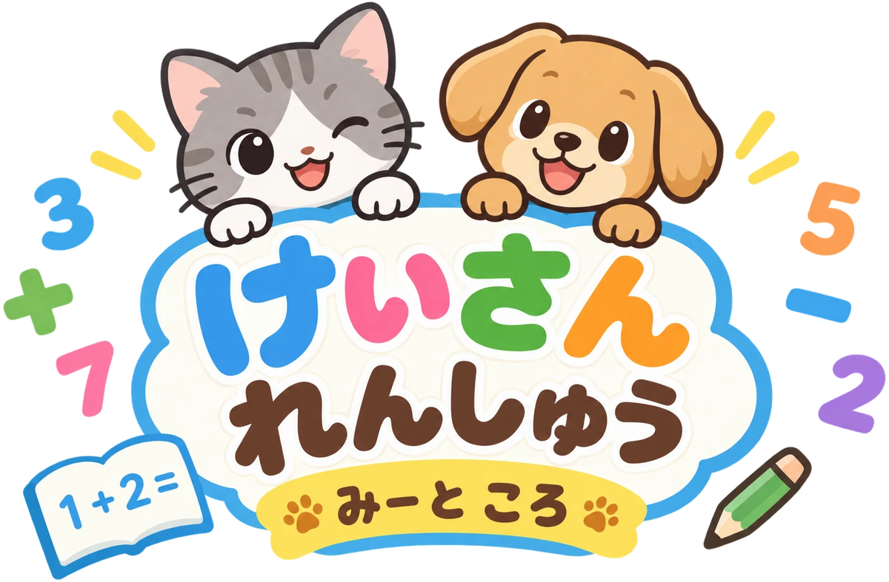

<p align="center">
  
</p>

<p align="center">
  <a href="https://kazukinakajimacat.github.io/keisan-renshu/"><b>▶ あそんでみる</b></a>
  ・
  <a href="CHANGELOG.md">更新履歴</a>
</p>

# けいさん れんしゅう　サービス紹介

小学1年生が、10までのたし算・ひき算を毎日楽しく続けるために作られたサービスです。ねこの みー と いぬの ころ が、いっしょに応援します。

---

## つくった目的

次の3つをテーマにしています。

1. 算数が好きになる
2. たし算とひき算がすらすら解ける基礎を作る
3. 毎日やっても飽きない

---

## 対象

- 小学1年生（たし算・ひき算を習い始めた子）
- 数の範囲は10まで。問題文はすべてひらがなと数字
- 答えは1〜10のボタンや絵のボタンを押して選ぶので、文字入力はいりません

---

## ホーム画面

開くと最初にホーム画面が出ます。きょうの めあて・きょうの シール・なかま の様子・コースのボタン（いろいろ もんだい／ます けいさん／とけい／ずかん）・おうちの方への記録 をまとめて見られます。
コースの画面では、上のバー（ホーム・いろいろ・ます・とけい・ずかん）で直接切り替えられます。問題の画面は、スマホでスクロールせずに答えられる大きさにしています（幅520px以下では、ブラウザのバーで見える高さが660px前後しかないiPhoneでも「わからない」まで見えるよう、さらに詰める。ちょう むずかしい の説明の1行は出さない）。

---

## コース

### いろいろ もんだい

1問ずつ答えるコースです。問題は開くたびにランダムで、何問でも続けられます。

出題パターン

| パターン | 例 |
|---|---|
| しき | 3 + 4 = ? |
| あなあき | 3 + ? = 7 |
| いくつと いくつ | 7 は 4 と ? |
| え を みて | 10のわくに並んだ丸を数える |
| おはなし もんだい | みーと ころが出てくる文章題（ぜんぶで・のこり・ちがい） |
| みっつの かず | 3 − 1 + 4 = ? |
| なんばんめ？ | 🐱🐶🐰🐻 まえから 3ばんめは？／うしろから 2ばんめは？（絵のボタンで答える） |
| どちらが なんこ おおい？ | りんご5こ と みかん3こ。りんごは なんこ おおい？ |
| あと いくつ？ | 🍎🍎🍎🍎 あと いくつで 7こ？ |
| 10に なるのは？ | 7 と ? で 10（10のわくの絵でも出る） |
| ならべかえ | 3 8 1 5 を ちいさい じゅんに（数字を順にタップ） |
| つぎの かず | 1 → 2 → 3 → ?／9 → 8 → 7 → ?（ふえる・へる 両方） |
| まえの かず・うしろの かず | 5の ひとつ まえは？ |
| かずを あてよう | ヒント2〜3こで ひみつの かずを当てる（答えは必ず1つ） |
| かずの れつ | 1 2 □ 4 5 |
| どちらが おおきい？ | 3 と 7、おおきいのは どっち？／ちいさいのは どっち？ |
| ひきざんの あなあき | 7 − ? = 3／? − 2 = 5 |
| おなじ こたえは どれ？ | 3 + 4 と おなじ こたえは？（式のボタン3つから選ぶ） |
| こたえが □に なるのは？ | こたえが 6に なるのは？（式のボタン3つから選ぶ） |
| しきの おおきさくらべ | 3 + 4 と 9 − 1、こたえが おおきいのは どっち？／ちいさいのは どっち？ |
| ＋かな？ −かな？ | 5 □ 2 = 3 の □に入る記号を選ぶ |
| あってる？ まちがい？ | 3 + 4 = 8 は あってる？（○ と × で答える） |
| しきを えらぼう | 文章題に合う式（5 + 2／5 − 2）を選ぶ。答えの数は求めない |
| しきを つくろう | 2 3 5 を □ + □ = □ に並べる（数字を順にタップ。入れた数字を押すと戻せる） |
| おかいもの | 10えん もって 7えんの あめを かいました。おつりは なんえん？ |
| まちがいを なおそう | 3 + 4 = 8（8が赤い）。ほんとうの こたえは？ |

レベル

| レベル | 内容 |
|---|---|
| かんたん | しき、絵、いくつといくつ、やさしい文章題。数の意味の問題は「見てわかる」ものが中心 |
| ふつう | あなあき、ちがいの文章題、同じ記号の3つの数が加わる。ヒントの問題や比べる問題が増える |
| むずかしい | +と−をまぜた3つの数が中心。ならべかえは4〜5こ、2ずつ増える数の列なども出る |
| ちょう むずかしい | 大きい数の計算や+と−まぜの問題を多めに、26パターンすべてから出題。1問10秒の時間制限つき（ならべかえ・ヒントの問題は少し長め） |

数の意味の問題（なんばんめ〜どちらが おおきい）と、式を考える問題（ひきざんの あなあき〜まちがいを なおそう）は、すべてのレベルで出ます。式を考える問題は、式に出る数も答えも1〜10で、0は使いません。問題の中身は `drill/patterns.js`、テストは `node tests/patterns.test.js`（10まで と 30まで の両方を確かめる）。

レベルが上がると、数が大きくなったり、向き（まえ・うしろ、ちいさい・おおきい）が入れかわったりします。

#### 10まで／30まで

難しさとは別に、数の範囲を「10まで」「30まで」から選べます（選んだ範囲は端末に残る。変えると20問をやり直す）。

- 30まで の計算：1けた±1けた（8＋7 のようなくり上がり、くり下がりもある）と、2けた±1けた（15＋6、21−7 など）。数も答えも1〜30で、0は使わない。2けた同士（12＋13）や、前が1けたの式（3＋15）は出さない。たし算225・ひき算225
- 30まで で出る問題：26パターンのうち23パターン。「なんばんめ？」「どちらが なんこ おおい？」「かずを あてよう」は 10まで だけ
  - みっつの かず：1つめは1〜29、たす・ひく数は1〜9、途中も答えも1〜30
  - あと いくつ？：めあては11〜30、足りない数は1〜9（数が多いので言葉で出す）
  - 10に なるのは？：30まで では「20に なるのは？」「30に なるのは？」も出る（上の札も変わる）
  - 式を考える10パターン（`drill/patterns.js`）は `Patterns.use(30)` で30までの式（1けた±1けた・2けた±1けた）を使う。おかいもの は10〜30えん持って1〜9えんの物を買う。しきを つくろう は、最初に見せる答えを「1けたを足す・引く」形にする（2けたのカードはキーボードでは選べないので、画面のボタンで）
- 答えは 0〜9 のボタンで2けたまで入れて「こたえる」（「けす」で1文字戻す）。スマホでスクロールしないよう、入れた数・けす・こたえる を1列にまとめ、数字ボタンと式の文字は少し小さめ。入れた数は青い枠・青い文字で出し、押した数字ボタンは一瞬青く光る（ボタンの数字と見分けやすくする。ます けいさん の30まで も同じ）。10を超える計算が出る挑戦コーナー（にがて・わからなかった もんだい）でも同じ
- ボタンを押す回数が多いので、すらすら・きらきら の時間と ちょう むずかしい の10秒は1.5倍で見る
- 10を超える数の絵は、10の わく を並べる（23 なら 10・10・3）。数の線は、出てくる数の入る10ごとの区切り（11〜20 など）を出す
- 10まで では、10を超える苦手な計算は混ぜない

### とけい

アナログ時計で時刻を学ぶコースです。10問でひとくぎり。めあて・シール・なかま にも数えます。

| むずかしさ | 出る問題 | 時刻 |
|---|---|---|
| やさしい | とけいを よもう・とけいを あわせよう | ちょうど・はん |
| ふつう | ＋ ○ぷん あと・○ぷん まえ（時をまたがない） | 10ぷん きざみ |
| むずかしい | 4種類（時をまたぐ問題が多め・40／50ぷんも出る） | 1ぷん単位 |

- 答えは じ と ふん をドラムロール（上下にスワイプ）で選ぶ。時計の針は指でドラッグでき、ボタンでも動かせる
- 時刻の計算は `clock/clock.js`、テストは `node tests/clock.test.js`

### ます けいさん

5×5の25ますを順番にうめていく、100ます計算の入門版です。たしざん・ひきざん・まぜまぜの3種類があり、タイムを計って自分の最高記録に挑戦できます。

- 「10まで／30まで」を選べる（いろいろ もんだい とは別に端末に残る）。30まで は、左が1けたか2けた・上が1けた、答えは1〜30（くり上がり・くり下がりあり）。たしざん：左5〜21、ひきざん：左10〜30、まぜまぜ：左は続いた5つの数（10〜25）
- 30まで の答えは 1〜9・0 のボタン（数字キー）で入れる。答えのけた数だけ押すと判定する（「けす」・Backspace で1文字戻す）。入れている途中の数はますに出る
- 最高記録は 10まで と 30まで で別。すらすら・きらきら の時間は1.5倍で見る

### ずかん

がんばりが目に見える場所です。

- すらすら ずかん：たし算225個・ひき算225個（30まで の式ぜんぶ）を、ページごとに「まえ」「つぎ」でめくって見る。たし算は「こたえが 10まで（45）」「こたえが 11〜18（1けた＋1けた の くり上がり）」「10〜19 ＋ 1けた」「20〜29 ＋ 1けた」の4ページ、ひき算は「10まで の ひきざん（45）」「11〜19 − 1けた」「20〜30 − 1けた」の3ページ。同じ式は2つのページに出さない。後ろの数の位置はそろえたまま空ける。ずかんを開くたびに1ページ目から。速く正確に解けた式にシールが付く。シールは3段階で育つ。「全部きらきら」のとくべつ シールは 10まで の90個で見る
  - すらすら：続けて2回、時間内に正解
  - ぴかぴか：別の日にも時間内に正解（2日分）
  - きらきら：さらに別の日に3秒以内で正解（3日分）
  - 一度付いたシールは、間違えても下がらない
- シール ちょう：毎日もらった日替わりシールが並ぶ。新しい順に12まいで1ページ、「まえ」「つぎ」でめくる（ずかんを開くたびに1ページ目から）
- スタンプ カレンダー：めあてを達成した日にスタンプが付く。前の月もさかのぼって見られる

---

## 続けたくなる仕組み

- なかま そだて：月のはじめに届くたまごが、めあてをクリアした日数で育つ（たまご2日 → あかちゃん3日 → こども4日 → わかもの4日 → おとな10日 → おとしより。生まれるのはクリア2日目、おとなは13日目、おとしよりは23日目）。3日続けて休むといえでしてしまい、翌日に新しいたまごが届く。ただし、育つのに必要な日数は月の途中でも短くしない（おとなまで13日）ので、その日から月末までに「おとな」に届かない時期（31日の月なら20日以降）は、たまごは届かず、次の月の1日に届く（家出のあとも、はじめて開いたときも同じ）。待っている間は、ホームに「つぎの たまご ○がつ ○にちに とどくよ」と出る。月末に旅立ってなかま ずかんに載る。生まれたら名前を付けられる（ひらがな5文字まで）
- なかまの絵は時間帯で変わる（ホームのなかまカード。端末の時刻で判定）
  - 6:00〜9:00 朝寝起き／9:01〜17:00 日中（4種類から開くたびにランダム）／17:01〜19:00 お風呂／19:01〜21:00 眠い／21:01〜5:59 布団で寝ている
  - 1日でも休んだ日は、その日にめあてをクリアするまで、しょんぼりの絵を優先する（言葉は1日目「さみしいな…」〈たまごは「はやく あいたいな…」〉、2日目「あいたいな… きょう めあてを クリアしてね」）
- MC：12しゅるいのなかまを全部旅立たせる（いえでは除く）と、好きななかまをMCに選べる（ずかん → なかま ずかん →「MCを えらぶ」）。なかまごとに性格と語尾が違い、問題・正解・まちがい・ヒントなどで話しかけてくれる。MCの名前は、育てたときに付けた名前で出る（付けていなければ元の名前）。いつでも みー と ころ に戻せる。12しゅるい集め終わると、なかま そだては終わり（新しいたまごは届かない）
- 生まれるなかまは、まだ集めていない種類から先に出るので、毎月続ければ12か月で全種類そろう

- きょうの めあて：1日10問。達成するとスタンプが押され、ここで終わってもよい、という区切りになる
- 日替わりシール：絵柄は毎日変わる。まだ持っていない絵柄から先に出るので、毎日続ければ全種類そろう（そろったら2周目。2回目の絵柄には「2まいめ」と付く）。持っている絵柄は端末ごとに違うので、同じ日でも端末ごとに違うシールになる。その日に20問でノーマル、50問でレア、75問でスーパーレア、150問でウルトラレアに進化し、翌日はまた0から（1日30分の区切りの中で届くように、2026-10-12 に 30・60・100・200問 から変更）
  - いろいろ もんだい：1問解くごとに1問
  - ます けいさん：1枚やりきったら、正解したますの数だけ足す（途中でやめたら0）。全問正解で自己ベストを更新したら、さらに+5問
- ウルトラレアだけは、光が走ってキラン！と光る
- とくべつ シール：何かを達成したときにもらえるシール。もらって初めて、シール ちょうの「とくべつ シール」に出る（まだの分は見せない。全部で何まいあるかも見せない）。タップすると、もう一度大きく見られる
  - これまでの正解数（いろいろ もんだい・ます けいさん・とけい の合計）が1000問ふえるごとに1まい（10000問まで）。今までに正解した分も数える。絵は みー と ころ のぼうけん（草原 → 山 → ロケット → 宇宙）
  - すらすら ずかんが全部きらきらになったとき（たしざん／ひきざん／両方 の3まい。10まで の90個で見る）
  - なかま 12しゅるい が全員旅立った「次の日」に、全員集合の記念写真（id: nk_all、絵は `milestone/nk_all.webp`、横長3:2。シール帳の小さい絵は真ん中を正方形に切ったもの）。「12ひき ぜんいん そだてきった きみに、ぜんいん しゅうごうの しゃしんを プレゼント！」と出る
  - すらすら ずかん の30まで のページ（シート）が全部きらきらになったとき：たしざん「こたえが 11〜18」「10〜19 ＋ 1けた」「20〜29 ＋ 1けた」、ひきざん「11〜19 − 1けた」「20〜30 − 1けた」の5まい（id: zk_a2・zk_a3・zk_a4・zk_s2・zk_s3。30より上を足すときも MS_LIST に並べる）。絵がまだない・確認中のものは `index.html` の `MS_HOLD` に id を入れると渡さない（今はなし）
  - 新しい種類は `index.html` の `MS_LIST` に足す。絵は `milestone/<名前>.webp`（大・900px）と `<名前>_s.webp`（小・240px）。まだ会っていない なかま を先に見せないよう、絵には みー と ころ だけを描く
- キャラクターの応援：正解すると喜び、間違えると励ましてくれる
- 正解の割合でひとこと：その日はじめて開いたときに、前の日の結果（解いた数・正解数・割合）でひとこと出す。その日も50問解くごとに、その50問の結果でひとこと出す（いろいろ・ます・とけい の合計。ます けいさん の途中なら終わってから）
  - 前の日（100%／70〜99%／50〜69%／50%未満）：きのうは ぜんぶ せいかい！／きのうも よく がんばったね！／きのうは おつかれさま／きのうは むずかしかったかな？
  - その日の50問ごと（同じ順）：ぜんぶ せいかい！ すごすぎる！／その ちょうし！／あと すこし！／いそがなくて いいよ
  - 前の日とその日で、見出し・ひとこと・ボタンの言葉はすべて別にしている（`index.html` の `accMsg`）
  - 割合は切り捨てで表示する（69.5% は 69%）
  - 絵は `chars/acc/`。前の日用（y100・y70・y50・y0：朝の太陽とノート）と、その日の50問ごと用（t100・t70・t50・t0：はちまきとえんぴつ）で分けている

---

## やりすぎを防ぐ仕組み

問題の画面（いろいろ もんだい・ます けいさん・とけい）を使った時間を数える。ホームと ずかん はいつでも見られる。

- 1回の時間（30分か45分。はじめは30分）遊ぶと、30分の休憩に入る。「きゅうけい しよう！」と出て、また使える時刻を時計の絵で知らせる。休憩は飛ばせない
- 1日の合計（区切りなし・30・45・60・90・120分。はじめは60分）に達すると、「きょうは ここまで！また あした やろうね！」と出て、その日は問題に進めなくなる
- 数えるのは、画面が表示されていて、最後に触ってから1分以内の間だけ（置きっぱなしの時間は数えない）
- 自分で30分以上休んだときは、1回の時間を0から数え直す
- 解いている途中の問題・ます けいさんの1枚は最後までできる。次の問題に進むところで止める
- 残り5分と1分で、画面の上に知らせが出る
- 「おうちの方へ：これまでの記録」の中で、1回の時間と1日の合計を変えられる。1日の合計に達した日は「きょうだけ 10分 のばす」もできる。子どもが自分で変えないよう、かけ算の確認が付く
- 時間の記録と設定は端末ごと。「記録と苦手データを消す」では消えない

---

## わからない問題・苦手な問題

- いろいろ もんだい の問題の下に「？ わからない」ボタンがある。押すと「いっしょに みてみよう」と答えを図で見せて、数問あとにもう一度出す。正解にも間違いにも数えない（シール・めあて・20問にも入らない）
- 「わからない」を押した問題は「わからなかった もんだい」に残る（最大60問）。ホームの「わからなかった もんだい」から、1回10問まで挑戦できる。正解するとリストから消える
- 「にがて もんだい」：これまでに2回以上解いて、正解が半分より少なくなった計算（10までのたし算・ひき算・3つの数）。ホームから1回10問まで挑戦できる。形（式・文章題・穴あき など）は毎回変わる
  - 3回続けて正解すると「そつぎょう！」と出て、にがて から外れる（ふつうの問題で解いた分も数える）。また間違えて正解が半分より少なければ、もう一度入る
  - そつぎょう の絵は `chars/grad/grad01〜` からランダム（同じ絵は続けて出ない）。枚数は `index.html` の `GRAD_N`
- 挑戦コーナーは、いろいろ もんだい で選んでいる難しさに関係なく「ふつう」で出す（ちょう むずかしい の10秒の時間制限もなし）。終わると元の難しさに戻る
- 挑戦コーナーの問題も、ふつうの問題と同じくシール・めあてに数える。0問のときも、ホームにボタンは出しておく（「いまは ないよ」と出て押せない）
- 挑戦コーナーを終えたときの「ちょうせん おわり！」の絵は、正解の数に関係なく、わからなかった もんだい は `chars/set/idk01〜03`、にがて もんだい は `chars/set/weak01〜03` からランダム（コーナーごとに、同じ絵は続けて出ない）

---

## パソコンのキーボード

- 数字キーで答える。10 は「1」→「0」と続けて押す（「0」だけでも 10）。「1」を押したときは、10 がある問題だけ、0.6秒「0」を待つ
- 30まで の数字ボタンは、数字キーで入れて Enter で答える。Backspace で1文字戻す
- 数字以外のボタン（絵・式）は、1・2・3… で前から順に選ぶ。「＋かな？ −かな？」は ＋・− キー、「あってる？ まちがい？」は O・X キーでもよい
- ならべかえ・しきを つくろう は、数字キーでカードを選び、Backspace で1つ戻す
- ます けいさん は数字キー。とけい は ↑↓ で時、←→ で分（ドラムは ←→ で時と分を切り替えて ↑↓ で動かす）
- Enter：つぎへ・こたえる・スタート・もういちど。お知らせが出ているときは Enter で閉じる
- 押しっぱなしでは答えない。名前やおうちの方の確認を入力する欄では使わない

---

## あてずっぽうを防ぐ仕組み

- 5問続けて間違えると、「いったん おちつこう」と出る
- 1秒より速く答えるのが3問続くと（正解・不正解に関係なく）、「ゆっくりで だいじょうぶ」と出る
- どちらも、5秒たつまで閉じられない。閉じると、そのまま続きから解ける
- いろいろ もんだい・とけい が対象。ます けいさん は速さをきそう練習なので、5問続けて間違えたときだけ出す（出ている間はタイムを止める）
- 時間切れは数えない。知らせのあとと、コースを変えたときは、0から数え直す

---

## 力がつく仕組み

- 間違えたら、正しい答えを10のわくの図と短い言葉で見せる
- 間違えた問題は4問あと、時間がかかった問題は6問あとにもう一度出す
- 苦手な計算は、日をまたいでも多めに出す。式・文章題・あなあきなど形を変えて出すので、丸暗記では解けない
- 正答率が下がってきたら自動で易しめに、高いときは難しめに調整する
- 2問続けて間違えたら、次は必ず解ける問題をはさむ（ちょう むずかしいを除く）

---

## 保護者向けの機能

- 20問ごとに、ミスの傾向をまとめて表示する
  - たし算とひき算の正答率、パターン別の正解数
  - ミスの種類（答えが1ずれる、記号の取り違え、時間切れ など）
  - 時間がかかった問題、いま多めに出している問題
- これまでのまとめを、あとから見返せる
  - カレンダーで見る。記録がある日は件数が出て、押すとその日のまとめ（20問・ます1まい・とけい ごと）が下に出る。‹ › で月を移る。はじめは記録がある一番新しい日を出す
  - 残すのは新しい方から400件まで（前は30件）。日付は `d`（YYYY-MM-DD）で残す。前の記録は「10/20 21:39」から年をおぎなって日を決める
- 更新情報：「おうちの方へ：これまでの記録」の下に「おうちの方へ：更新情報」。`CHANGELOG.md` をそのまま読み込み、記録と同じカレンダーで日を選んで見る（読み込めないときは出さない）。直近1週間（今日を入れて7日）の更新がある日と見出しに、赤字で「New」
- 学習のようす（グラフ）：「おうちの方へ：これまでの記録」の中で、期間（7日・30日・90日・ぜんぶ・日付で選ぶ）を決めて見られる
  - 遊んだ時間（分）のグラフ。2026-10-12 から記録（それより前は0分と出る）
  - 解いた数と正答率のグラフ。はじめから記録がある
  - すらすら解ける計算・苦手な計算：期間中に「すらすら／ぴかぴか／きらきら」になった計算、すらすら解けている計算、苦手な計算（ミス・時間がかかった回数つき）、期間の前半と後半をくらべた変化（よくなった計算・まだ苦手な計算）
  - 計算ごとの日ごとの記録は 2026-10-12 から残す（100日分。10までのたし算・ひき算90こが対象）
  - 46日以上の期間は、グラフを1週間ごとにまとめる。グラフにカーソルを合わせるか指で触れると、その日（週）の数字が出る（棒グラフは棒のすぐ上、正答率はグラフの上のすきま。背景は透明で、うしろの棒や線を隠さない）
  - 期間に関係なく、「いま苦手として多めに出している計算」「前は間違えていたけれど、今はすらすら解ける計算」も同じ場所に出る
  - 以前あった「これまでの傾向」（はじめの頃と最近の比較）は、このグラフに一本化した

傾向は20問という少ない数から出しているので、1回分は目安です。2〜3回続けて同じ傾向が出たら、苦手と見るのがよさそうです。

---

## 記録の保存

- 記録は、使っている端末のブラウザの中（localStorage）だけに保存されます。ページを閉じても消えません
- サーバーには何も送らないので、ほかの人の記録が自分の端末に混ざることはありません
- 端末やブラウザが違えば、記録も別々です（家族で端末を分ければ、それぞれの記録になります）
- ブラウザの「履歴・サイトデータを消去」をすると記録も消えます
- 保存の状態は、ページの下に表示されます

---

## なかまの追加方法

1. `nakama/<id>/` フォルダに絵を入れる（egg_n, egg_h, baby_n/h/s, child_n/h/s, young_n/h/s, adult_n/h/s, elder_n/h/s, depart, letter。すべて .webp。letter がなければ共通の手紙を使う）
   - 時間帯の絵（なくても動く）：`<段階>_t_<時間帯>.webp`。段階は egg / baby / child / young / adult / elder、時間帯は morning / day1〜day4 / bath / sleepy / night
2. `nakama/nakama.js` のリストのいちばん最後に1行足す
3. 絵の作り方は `docs/ideas/nakama-sodate.md` を参照

---

## シール素材の追加方法

1. 画像（PNG・背景透明・正方形・256px 程度）を `stickers/` フォルダに入れる
2. `stickers/stickers.js` のリストの**いちばん最後**に1行足す
   ```js
   { id: "ファイル名と同じ英数字", name: "シールのなまえ", file: "ファイル名.png" },
   ```
   背景つきの丸いシールは `round: true` を付けると、枠いっぱいに大きく表示される
3. GitHub に push すると反映される

- `id` は一度決めたら変えない（もらったシールの記録に使うため）
- 行の順番を入れ替えたり、消したりしない
- もう出したくないシールは、行を消さずに `retired: true` を付ける（もらったシールはシール帳に残る）
- すでにもらったシールの絵柄は、素材を追加しても変わらない

---

## これから考えていること

- 繰り上がり・繰り下がりを習ったら、数の範囲を20までに広げる
- ます けいさんを、本来の10×10の100ますにする
- 文章題の読み上げ
- シールやキャラクターの種類を増やす

---

## 利用について

- サービス（公開しているページ）は、どなたでも無料でお使いいただけます
- このリポジトリのプログラム・イラスト（みー と ころ、なかま、シール、ロゴ など）・文章の権利は、作者が保有しています
- 無断での転載・再配布・改変しての公開・商用利用はご遠慮ください

© 2026 kazukinakajimacat. All rights reserved.（くわしくは [LICENSE](LICENSE)）
